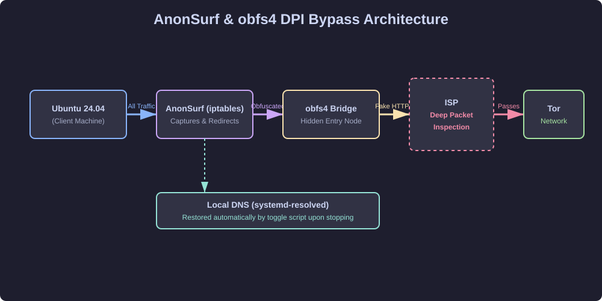
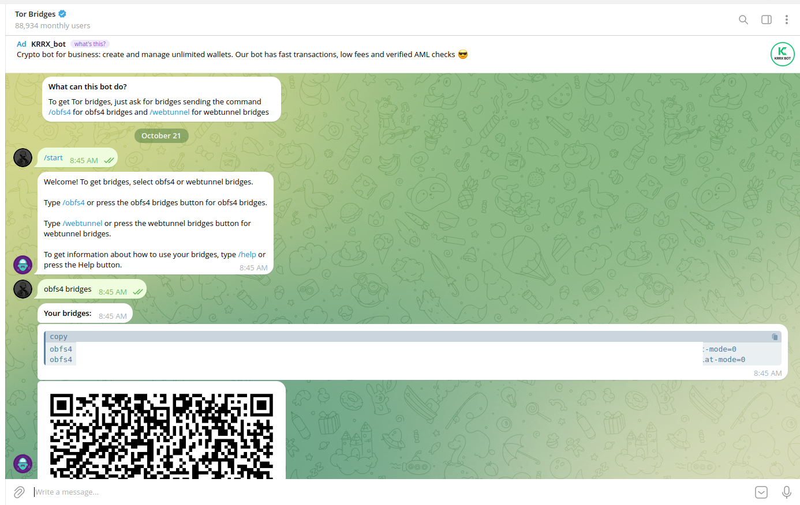
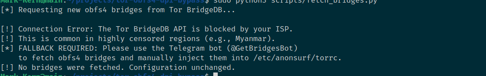
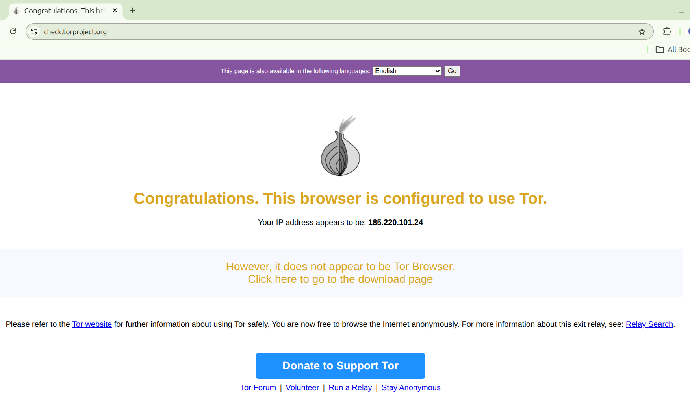

# 🛡️ Bypassing ISP-Level Tor Censorship with AnonSurf & obfs4

## 📌 Executive Summary
In regions with strict internet censorship (such as Myanmar), Internet Service Providers (ISPs) employ Deep Packet Inspection (DPI) to block access to privacy-enhancing tools like the Tor network. Standard Tor connections are easily detected and dropped, while DNS poisoning breaks the ability to resolve domain names.

This project demonstrates the successful deployment of **AnonSurf** on Ubuntu 24.04, combined with **obfs4 Pluggable Transports (Bridges)**. By disguising Tor traffic as standard HTTPS traffic, we successfully bypassed ISP censorship. Furthermore, this repository includes custom automation scripts to handle critical DNS resolution failures that occur when toggling between clearnet and Tor networks.

## 🏗️ Architecture & Concept
To bypass censorship, we utilize a multi-layered approach:
*   **AnonSurf:** Uses `iptables` to transparently capture all system traffic and force it through the Tor network, preventing clearnet leaks.
*   **Tor (The Onion Router):** Routes encrypted traffic through a decentralized network of relays, hiding the user's original IP address.
*   **obfs4:** A Pluggable Transport that scrambles the Tor handshake so that to an ISP, the traffic looks like a normal, random HTTPS connection.
*   **Bridges:** Unlisted Tor entry nodes that are not publicly known, making them harder to block.

### Data Flow Diagram


*Figure 1: Visual representation of traffic routing through AnonSurf, obfs4, and the Tor network.*

## 🛠️ Step-by-Step Installation Guide

**Prerequisites:** Ubuntu 24.04, `sudo` privileges, and a working internet connection for the initial setup.

### 1. Install Dependencies

```bash
sudo apt update
sudo apt install git tor obfs4proxy iptables -y
```

### 2. Install AnonSurf

Clone the Debian/Ubuntu compatible AnonSurf repository and build the package.

```bash
git clone https://github.com/rajprins/anonsurf.git
cd anonsurf
sudo ./00-install-deps.sh
mkdir -p dist
./01-package.sh
sudo ./02-install.sh
```

### 3. Configure obfs4 Bridges

Request obfs4 bridges via the Telegram bot (`@GetBridgesBot`) or the Tor Project website. 


*Figure 3: Fetching unlisted obfs4 bridges via Telegram to bypass DPI.*

```bash
sudo mkdir -p /etc/anonsurf
sudo nano /etc/anonsurf/torrc
```

Add the following lines:

```text
UseBridges 1
ClientTransportPlugin obfs4 exec /usr/bin/obfs4proxy
Bridge obfs4 <IP>:<PORT> <FINGERPRINT> cert=<CERTIFICATE> iat-mode=0
```

---

## 🚑 Real-World Troubleshooting Log

During deployment, we encountered and resolved several critical errors:

* **Build Error (`dist/anonsurf.deb` not found):** The build script lacked a `dist` directory. Fixed by running `mkdir -p dist` before `./01-package.sh`.

* **DNS Breakage (`Temporary failure in name resolution`):** When AnonSurf stops, it fails to restore Ubuntu 24.04's `systemd-resolved` symlink, breaking all DNS. We resolved this by creating the `anonsurf-toggle.sh` script, which automatically fixes the `/etc/resolv.conf` symlink upon stopping.

* **Tor Not Running on Start:** The default `tor` service in Ubuntu is a master instance. AnonSurf requires the `tor@default` instance. This was resolved by ensuring bridges were correctly formatted and the Tor service was restarted.

* **Python Bridge API Blocked (`[Errno 101] Network is unreachable`)**
  *   **Cause:** While standard internet traffic (Google, YouTube) worked, the ISP's DPI specifically blocked access to `bridges.torproject.org`. This prevented the Python script from auto-fetching bridges.
  *   **Resolution:** This is an expected constraint in highly censored environments. The Python script was updated to catch `ConnectionError` and gracefully inform the user to use the manual fallback: fetching bridges via the `@GetBridgesBot` on Telegram.
  
  *Figure 4: Python script correctly identifying ISP DPI blocking the Tor BridgeDB API.*

## ✅ Verification & Testing Methodology

* **API Verification:** `curl -s https://check.torproject.org/api/ip`
  * *Expected Output:* `{"IsTor":true,"IP":"<Tor_Exit_Node_IP>"}`

* **Browser Verification:** Navigate to [check.torproject.org](https://check.torproject.org) in Chrome. 
*Figure 2: Verification of successful Tor routing via check.torproject.org.*

* **DNS Leak Test:** Ensure DNS requests are not leaking to the local ISP via `dnsleaktest.com`.

---

## 🚀 Future Roadmap

* **Python Bridge Auto-Fetcher:** A script to automatically query the Tor BridgeDB API, extract `obfs4` lines, and inject them into `/etc/anonsurf/torrc`.
* **GUI Integration:** Creating a system tray icon to toggle the tunnel with a single click.

---

> **Disclaimer:** This project was created for educational purposes and to bypass state-level censorship for accessing free information. Always adhere to local laws.

> 📝 **Read the full case study on Medium:** [How I Bypassed Myanmar’s ISP Censorship](https://medium.com/@maungkhant.sec/how-i-bypassed-myanmars-isp-censorship-using-python-tor-and-bash-42d266d9d785?sharedUserId=maungkhant.sec)
